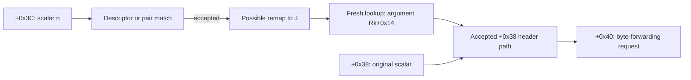

# Xbox turn command flow

The Xbox build of Civilization Revolution (version 1.3) starts and ends a round
with a chain of internal commands. They are the commands numbered 46 through 55,
plus a reply numbered 60. Together they record which players have finished,
start the AI, compare a sample of game state between machines and advance the
calendar. Each command is a five word record queued through
`NetworkCommandSubmit` and run by the dispatcher; the record, the queue and the
dispatcher are described in [Xbox network messages](xbox-network-messages.md).

The game's own debug text names each type (`BeginTurn`, `ImDone`, `EndTurn`,
`SynchCheck` and so on). The [label block record](../../../manifests/xbox-turn-label-block.json)
(`RVA-F-0411`) shows where that text sits. Those names tell a modder what the game calls a type.
They do not prove that a command is sent, received or processed, and they do not
prove any readiness, barrier or checksum behavior. Every relation on this page is
read from the guest code. No run has observed the order of these commands in a
live match.

## How a human turn completes

This is the path the code allows when one local human finishes a turn in a match
with AI players. Each step is a call or branch in the guest code, not an observed
event.

1. **The human finishes.** `TurnSelectionUpdate` (`0x82D259E8`) has a guarded path
   for a local human. It submits type 50 (`ImDone`) for the selected player, with
   -1 for `arg2` and `arg3`, the stored word `0x82F7AD00` as `arg4` and a separate
   target of -1. An AI player takes the other branch, which submits type 52
   (`AIDone`) through `0x82CD5848`. What the human does to reach this path is not
   identified (see [Local human completion](#local-human-completion)).
2. **Case 50 counts the finished players.** It sets the player's bit in
   `0x830EE7E0` and stores 999 at `0x830EE7D8`. After a call to `0x82D8AA60`
   returns nonzero, it compares the mask with the human player mask `0x8312E608`.
   When they are equal and the one-shot flag `0x83157E4C` is zero, it sets the
   flag, calls `0x82D038E8` and submits type 48 (`BeginTurnAI`). Type 51
   (`ImNotDone`) clears a player's bit, only for a human player. Type 52 sets a bit
   with no check.
3. **Case 48 starts the AI step.** It sets bit `0x4000` in the shared status word
   `0x82FFE7C4`. On a guarded path it submits type 53 (`ImDoneAI`) and passes its
   own `arg1` as the new record's `arg2`.
4. **Case 53 records the player and may compare state.** It stores `arg2` at
   `0x8312E5C0 + 4 * arg1` and sets bit `arg1` in the receipt mask `0x83157E48`.
   A scan of the other players then looks for any whose stored scalar differs from
   a fresh sample from `0x82CD4CF0`. If one does, the case submits type 55
   (`SynchCheck`) with that sample as `arg1` and the stored word as `arg2`.
5. **Case 55 compares and replies.** A data or seed mismatch makes it build a
   diagnostic message and set mismatch bit `0x10` in `0x82FFE7C4`. On every normal
   path it then submits type 60 with a fresh sample. Case 60 stores that sample in
   the same `0x8312E5C0` array.
6. **Every route past the case 53 entry check reaches one type 54 submit.** Case 54
   (`EndTurn`) clears bit `0x10` and enters `0x82D0C3E8`, which loads the current
   turn and stores the matching year.
7. **The next round begins.** Case 46 (`BeginTurn`) calls `CalendarTurnAdvance`,
   clears three state words and submits type 49 (`BuildDone`) with the local player
   index. It then compares the type 49 mask with the human player mask and loops
   back while they differ. Case 47 (`BeginTurnReload`) does the same without the
   second submit site, and seeds the mask from the human player mask when a switch
   word is zero.

A calendar increment or a queued request alone does not count as a completed world
round. Directly submitting type 54 skips steps 2 through 5.

## Command reference

| Type | Label | Static role |
| ---: | --- | --- |
| 46 | `BeginTurn` | Calls `CalendarTurnAdvance` (`0x82D1EAB0`), submits type 49 at two sites (`0x82CDE280`, `0x82CDE36C`) and calls the follow-up `0x82D1D1C0`. Clears three state words first and loops until the type 49 mask equals the human player mask. |
| 47 | `BeginTurnReload` | Calls `CalendarTurnAdvance`, submits type 49 at one site (`0x82CDE528`) and calls the same follow-up. Clears the type 49 mask, or seeds it from the human player mask when `0x8314F1B0` is zero. |
| 48 | `BeginTurnAI` | Sets bit `0x4000` in `0x82FFE7C4`. On a guarded path submits type 53 with its `arg1` as the new `arg2`. |
| 49 | `BuildDone` | ORs a mask built from `arg1` into the type 49 mask `0x83157E44`. |
| 50 | `ImDone` | Sets the player's bit in `0x830EE7E0`. When that mask equals the human player mask, sets a one-shot flag and submits type 48. |
| 51 | `ImNotDone` | Clears the player's bit in `0x830EE7E0`, only when `IsHumanPlayer` returns true. |
| 52 | `AIDone` | Sets the player's bit in `0x830EE7E0` with no check. |
| 53 | `ImDoneAI` | Stores `arg2` per player, sets the receipt bit, may scan for differing players, may submit type 55, then submits type 54 once past the entry check. |
| 54 | `EndTurn` | Clears mismatch bit `0x10` and enters the turn and year update. |
| 55 | `SynchCheck` | Compares `arg1` with a fresh sample and `arg2` with the stored word, then submits type 60. |
| 60 | none recorded | ORs a mask for `arg1` into `0x83157E40` and stores `arg2` in the `0x8312E5C0` array. |

The two numbered cases 25 and 44 sit outside this chain. They share one branch
that creates special unit type 30 for `arg1` and stores `arg2` as the Great
General carrier link. Neither case is named `AddGeneral`; the reason for two cases
and the award timing are unresolved. See
[the attachment record](../../../manifests/xbox-network-message-root.json#/greatGeneralAttachmentAnchor).

### State words the chain reads and writes

| Address | Meaning | Written by | Read by |
| --- | --- | --- | --- |
| `0x83157E44` | Type 49 mask | 49 sets a bit; 46 clears; 47 clears or seeds | 46 compares it with the human player mask |
| `0x83157E48` | Receipt mask | 53 sets a bit; 46 and 47 clear | 53 compares it with the human player mask on entry |
| `0x83157E4C` | One-shot flag | 50 sets; 46 clears; 47 clears on the short path | 50 requires zero |
| `0x830EE7E0` | Finished players | 50 sets, 51 clears, 52 sets | 50 compares with the human player mask |
| `0x830EE7D8` | Sentinel | 50 stores 999 | no reader found here |
| `0x83157E40` | Reply mask | 60 sets a bit | 53 waits for it to equal the human player mask (see below) |
| `0x8312E5C0` | Per player scalar array | 53 and 60 store `arg2` | 53 scans compare it with a fresh sample |
| `0x8312E608` | Human player mask | rebuilt by `0x82CD59A8` | 46, 50, 53 |
| `0x82FFE7C4` | Shared status word | 48 sets `0x4000`; 55 sets `0x10`; 54 and 55 clear `0x10` | many other functions test its bits |
| `0x8314F1B0` | Source word for the human mask rebuild and the case 47 branch | no writer found here | 47, the entry check of 53 and `0x82CD59A8` |

## Type 49 and the human done mask

Type 49 reads only `arg1`. Words `0x82CDE60C..0x82CDE620` form a PowerPC `slw` mask
from `arg1`, load `0x83157E44`, OR the mask in and store the result. The branch
that follows goes to the common dispatcher exit `0x82CE16AC`, a relation known from
the recompiled copy of the function only. `slw` produces zero when the shift
operand has bit `0x20` set, so an index with that bit set sets nothing.

All three static submit sites pass the `LocalPlayerIdResolve` (`0x82D8A3A0`) result
as `arg1`, -1 as `arg2` and `arg3`, the stored word `0x82F7AD00` as `arg4` and -1
as the separate target. The helper `0x82D038E8` runs between the local player
lookup and each submit. It has three direct callers, no callees and two returns,
stores a frame timing value at `0x830E3CF4` (zero on its null path) and never
writes `r4`, so the player index reaches the submit unchanged.

Case 46 stores zero to `0x83157E4C`, `0x83157E48` and `0x83157E44` before either
submit site. After the sites it loads the type 49 mask and the word at `r31 + 0x48`
(the human player mask), compares them and branches back to `0x82CDE390` while they
differ. Case 47 reads `0x8314F1B0` at `0x82CDE44C`. When the word is nonzero it
clears `0x83157E48` and `0x83157E44` before its submit. When it is zero the branch
at `0x82CDE454` goes to `0x82CDE590`, which stores the human player mask into
`0x83157E44` and clears `0x83157E4C` and `0x83157E48`. These relations do not show
a barrier, a successful receipt or a disabled network.

Ghidra records no direct reference to `0x83157E44`, because the address is built
from two instructions. A search for direct submit calls with type 49 finds nothing
because Ghidra's listing of the dispatcher stops at a known thunk block. The
recompiled copy of the function contains exactly three type 49 submit pairs
(`0x82CDE27C` with `0x82CDE280`, `0x82CDE368` with `0x82CDE36C` and `0x82CDE524`
with `0x82CDE528`). Ghidra's reference model cannot confirm that count.

## ImDone, ImNotDone, AIDone and BeginTurnAI

Case 51 calls `IsHumanPlayer` with the value at `0x8312B8E4`. Only when it returns
true does it clear `1 << arg1` in `0x830EE7E0`. Case 52 sets the same bit with no
check. Case 50 sets the bit, stores 999 at `0x830EE7D8` and, after the nonzero
`0x82D8AA60` call, compares the mask with `0x8312E608`. Equality while
`0x83157E4C` is zero sets that flag, calls `0x82D038E8` and submits type 48.
Equality with the human player mask does not prove readiness, an end of the setup
phase or a delivered request.

Case 48 sets bit `0x4000` in `0x82FFE7C4`. On its guarded completion path it moves
its `arg1` into the submit's `arg2`, loads type 53 and calls `NetworkCommandSubmit`.
The chain 50 to 48 to 53 is a static relation. Whether the guard is reached, who
may reach it and the meaning of case 53 are open.

## ImDoneAI and its two scans

Case 53 stores `arg2` at `0x8312E5C0 + 4 * arg1` and sets `1 << arg1` in the receipt
mask `0x83157E48`. The
[resync target selection](../../../manifests/xbox-resync-target-selection.json) record
gives the entry condition. The body continues when `0x82D8AA60` reports the local
peer as host and the receipt mask equals the human player mask, or when
`0x8314F1B0` is nonzero. The second condition can statically allow a peer that is
not the host.

### First scan: does any player differ?

The scan sets a case-local predicate, which starts at zero and can become one. It
starts at index 0 and runs only when the signed word at `0x82F700AC` is greater than
zero. It advances the index by one, a displacement by `0x80` and the
`0x8312E5C0` pointer by 4, and repeats while the incremented index is signed less
than the reloaded `0x82F700AC`. Its constant data bases are `0x830ED0D8`, `0x830E5650`
and `0x830E5AD0`.

A fresh sample from `0x82CD4CF0` is taken before the loop. Inside one iteration the
predicate becomes one only when all of these hold, in this address order:

| Address | Requirement |
| --- | --- |
| `0x82CDE9B8..0x82CDE9C4` | The loop index differs from `LocalPlayerIdResolve` of manager `0x8314EFE0`. The local player's own index is skipped. |
| `0x82CDE9C8..0x82CDE9D8` | The low byte of `0x82CD5A70(index)` is nonzero. |
| `0x82CDE9DC..0x82CDE9EC` | `0x82D8AB00(manager, index)` is nonzero. |
| `0x82CDE9F4..0x82CDEA10` | Bit `0x100` is clear in the word at `0x830ED0D8 + 4 * (8 * LocalPlayerIdResolve + index)`. |
| `0x82CDEA14..0x82CDEA24` | `0x82D8F700` of the pointer at `0x8314EFDC` and the index does not return one. |
| `0x82CDEA54..0x82CDEA5C` | `0x8312E5C0 + 4 * i` differs from the fresh sample. |
| `0x82CDEA28..0x82CDEA50`, `0x82CDEA60..0x82CDEA68` | The selected low byte flag is zero (below). The flag is built first and tested last. |

The flag is zero exactly when at least one of two player indexed words is nonzero
and the byte `0x8314EF9F` is zero. When both words are zero, or the byte is
nonzero, the flag is one and the predicate is not set. The two words are read at
`0x82CDEA28` and `0x82CDEA34` (a nonzero first word goes to the byte test at
`0x82CDEA40`. A zero first word with a nonzero second word also reaches it. Both
words zero go straight to the value one at `0x82CDEA50`). The two per iteration
word bases `0x830E5650` and `0x830E5AD0` are loaded through the `0x80` stride, but
the arrays and the helper results stay unnamed. The resync record lists the two word checks as city or settler tests.

Function `0x82D05D50` stores zero to `0x8314EF9F` on its straight line entry path.
`0x82D217C8` calls it at `0x82D217E0`. A corrected 32 bit displacement scan of the
defined instruction listing finds that store as the only match, and initialized
memory holds no aligned pointer to the byte. Ghidra's reference model lists the
store as the one reference to the byte, omits the call to the function and omits
the read at `0x82CDEA40`, so this is not a full access list. A writer that makes the
byte nonzero is not ruled out.

Ghidra records four other reads of the limit word `0x82F700AC`, at `0x82CF0454`
(function `0x82CF0268`), `0x821BD7FC` (function `0x821BD7F8`), `0x82D25268`
(function `0x82D25170`) and `0x82CEFC5C` (function `0x82CEFC50`). Three are
signed positive checks. `0x821BD7F8` compares its incoming `arg1` with the word and
skips a following mask path when `arg1` is at least the word. `0x82CEFC50` starts
with a zero return and returns at once when the word is not positive. Ghidra omits
the four reads in case 53 (`0x82CDE984`, `0x82CDEA70`, `0x82CDEB18`, `0x82CDEBE0`)
and records no writer. The writer, the value and the full list of accesses remain
unknown, and so does the fixed count of the loop.

### What happens when the predicate is set

After the scan the low byte of the predicate is tested at `0x82CDEA8C`. Zero sends
control to the common site `0x82CDEC1C`, which skips both type 55 submits. Otherwise
the halfword at `0x82F77454` chooses the path (`0x82CDEA9C`, `0x82CDEAA4`):

- A nonzero halfword takes the first path. It calls `0x82CD4CF0`, loads the stored
  word and submits type 55 at `0x82CDEAD0` with the sample as `arg1` and the stored
  word as `arg2`. The resync record adds that the body then clears `0x83157E40` and
  pumps `0x82E2A838` until that mask equals the human player mask, and that a failed
  pump leaves the loop. The second scan (below) follows, and a branch at
  `0x82CDEBF4` sends this path to `0x82CDEC1C`.
- A zero halfword takes the alternate path at `0x82CDEBF8`. It builds the same two
  arguments and submits type 55 at `0x82CDEC18`, then falls through to
  `0x82CDEC1C`.

All three routes reach the single type 54 submit at `0x82CDEC40`. A call that
fails the entry check does not reach it. Why the halfword
selects two paths, and how often either path runs, are unknown.

### Second scan: which players get a resync prompt

The second scan takes a fresh `0x82CD4CF0` sample (`0x82CDEB14`), starts at index 0
and runs only for a positive `0x82F700AC`. It advances the index by one and one
pointer by 4, and repeats while the incremented index is signed less than the
reloaded limit. In one iteration the body runs only when all three checks pass:

- The index differs from `LocalPlayerIdResolve` of manager `0x8314EFE0`
  (`0x82CDEB44..0x82CDEB50`).
- The low byte of `0x82CD5A70(index)` is nonzero (`0x82CDEB54..0x82CDEB64`).
- The current iteration word at `0x8312E5C0 + 4 * i` differs from the fresh
  sample (`0x82CDEB68..0x82CDEB70`).

The [resync target selection](../../../manifests/xbox-resync-target-selection.json)
record shows that this scan selects every peer whose stored scalar differs, with no
early exit. A selected peer shows a dialog and never its own name. Other peers show
a banner naming it. The scalar from `0x82CD4CF0` is a sum, so changes that cancel
are not seen, and the record lists the fields it sums: units, players, cities and
wonders, with AI research lists excluded. A scalar projection is not a bulk
recovery snapshot. The
[scalar and phase record](../../../manifests/spaceship-part-presentation.json#/worldActorSaveSyncProjectionBoundary)
gives the selected unit contribution and sample timing, and notes that a nested
command drain can run before actor retirement.

The body initializes a stack object at `r1+0xA0`. The table lists every store in
the window, all relative to the object start:

| Offset | Width | Value | Address |
| ---: | ---: | --- | --- |
| `+0x00` | word | `0x82136930`, then `0x8211EC1C` after the call window or when the call is skipped | `0x82CDEB84`, `0x82CDEBDC` |
| `+0x04` | byte | 1 | `0x82CDEBB0` |
| `+0x05` | byte | 0 | `0x82CDEB74` |
| `+0x08`, `+0x0C` | word | 0 | `0x82CDEB94`, `0x82CDEB98` |
| `+0x10` | word | 13 | `0x82CDEB88` |
| `+0x14` | word | 0 | `0x82CDEB8C` |
| `+0x18`, `+0x1C`, `+0x20` | word | -1 | `0x82CDEB9C`, `0x82CDEB80`, `0x82CDEBA0` |
| `+0x24`, `+0x28` | word | 0 | `0x82CDEBA4`, `0x82CDEB78` |
| `+0x2C` | word | 1 | `0x82CDEBA8` |
| `+0x30` | byte | 0 | `0x82CDEBAC` |
| `+0x34` | word | the loop index | `0x82CDEB90` |

Then the body loads manager `0x8314EFE0` (`0x82CDEB7C`) and its `+0x10` child
(`0x82CDEBB4`). A null child skips the call. Otherwise it passes the child, the
stack object and the literal one as arguments 1 through 3 to the child's virtual
slot `+0x44` (`0x82CDEBCC..0x82CDEBD8`). The table covers `[+0,+0x38)` as one
construction window. It is not a declared size, a recovered type, a serialization
layout or a lifetime model, and the child, the call and the literal one are
unnamed. How often the body runs, whether it is reached and what the helpers and
array elements mean remain unknown. The case 53 words leave the dynamic target unresolved, so no vtable slot
is cataloged. The resync record reports that the service slot `+0x44` reaches
`0x82CA6500`, which tries delivery to all present peer entries (of 8) and not only
the selected index.

## SynchCheck and EndTurn

Case 55 starts at `0x82CDEC48`. Words `0x82CDEC54..0x82CDEC5C` clear bit `0x10` in
`0x82FFE7C4`. A sampled network byte `0x8314F10B` must be nonzero to enter either
comparison.

- The data comparison: `0x82CDEC64` calls `0x82CD4CF0` and `0x82CDEC68` compares
  its return with `arg1`. A mismatch builds the data mismatch message text at
  `0x821574F8` (words `0x82CDEC78` and `0x82CDEC7C`) and calls the diagnostic
  helper.
- The seed comparison: `0x82CDEC90` loads the stored word and `0x82CDEC94` compares
  it with `arg2`. A mismatch builds the seed mismatch message text at `0x82157508`
  (words `0x82CDECA4` and `0x82CDECA8`) and calls the same helper.
- Either mismatch sets bit `0x10`. Equal, unequal and skipped branches meet at
  `0x82CDECB4`.

The case then continues. After an optional presentation path every normal branch
meets at `0x82CDED24`. That site takes a fresh `0x82CD4CF0` scalar and calls
`0x82D8A3A0` with the network manager pointer, copying the result to `r4` before
`0x82D038E8`. At `0x82CDED58` it submits type 60 with that index as `arg1`, the
scalar as `arg2`, -1 as `arg3`, the current stored word as `arg4` and a separate
target of -1. This is a new sample, not an echo of the received scalar, and it is
not proof of repair. Case 60 (`0x82CDED60`) ORs `slw(1, arg1)` into `0x83157E40` and
writes `arg2` at `0x8312E5C0` plus the index displacement (`arg1` rotated left 2 and
masked with `0xFFFFFFFC`). That is the array the case 53 scans read. A shift operand
with bit `0x20` set yields a zero mask. The stores do not test bit `0x10`, prove a
valid index, show a complete peer reply, apply a bulk snapshot or acknowledge
anything. No acknowledgement name or arrival order is established. The exact
conditions are in the
[case 55 return record](../../../manifests/xbox-network-message-root.json#/turnAndSyncAnchors/case55/returnSubmissionBoundary)
and the
[case 60 record](../../../manifests/xbox-network-message-root.json#/turnAndSyncAnchors/case60).

The strings are native text, and the string addresses and case roles are static.
The [label block record](../../../manifests/xbox-turn-label-block.json) (`RVA-F-0411`)
shows that both error strings are defined and that Ghidra reports no reference
to either, so the case 55 producers above come from the recompiled copy and the
exact words, not from a Ghidra reference. The label block also holds the text
`AddGeneral` at `0x82156CBC`, which no recorded route ties to type 25 or 44.
Checksum coverage of case 55 is unknown. The unverified PS3 name `ImBusy` is not
adopted for it.

Case 54 (`0x82CDED8C`) loads `0x82FFE7C4`, clears bit `0x10` and stores it
(`0x82CDED90..0x82CDED98`), then calls `0x82D0C3E8` at `0x82CDED9C`. Inside that
helper, `0x82D0C400` loads the current turn `0x8312B8DC`, `0x82D0C470` calls
`TurnToYear` (`0x82CEFA20`) and `0x82D0C490` stores the result at the current year
`0x8312B8E0`. Ghidra's listing of `0x82D0C3E8` stops at the second thunk block, so no
checksum or sync finalization algorithm is established. The recompiled copy shows a
large game state routine with a direct edge to `TurnToYear`, which rules out a narrow
checksum reading without proving a reusable role for the helper. Case 54 is not
identified as the unverified PS3 `Checksum` message.

## The stored word 0x82F7AD00

Types 49, 50 and 60 carry this word as `arg4`, and cases 53 and 55 use it as the
second compared value. The
[RNG transfer contract](../../../manifests/combat-rng-save-reload.json#/headerStateTransferBoundary)
identifies it as the current main random number generator state, with a
save and load transfer that runs only under conditions. It does not prove complete
generator restoration, and it is not an immutable map seed.

Four candidate writers store to it. Three copy the `+0x134` word of the object at
pointer global `0x8314EFC8`; the fourth copies a local record field.

| Function | Store | Source |
| --- | --- | --- |
| `0x82E2C010` | `0x82E2C2A0` | `+0x134` word of the object at `0x8314EFC8` (load `0x82E2C29C`; address words `0x82E2C218`, `0x82E2C27C`). |
| `0x82D86400` | `0x82D86854` | Local record field `+0x0C` at `r1+0xAC` (load `0x82D86838`). |
| `0x82E2A638` | `0x82E2A658` | ABI parameter 2. The caller `0x82D217C8` loads the `+0x134` word of the same object (`0x82D21E54..0x82D21E5C`) and calls at `0x82D21E60`. |
| `0x82E2E078` | `0x82E2E2CC` | `+0x134` word of the same object (load `0x82E2E2B0`; address words `0x82E2E264`, `0x82E2E268`, `0x82E2E274`, `0x82E2E27C`; dereference `0x82E2E298`). |

Caller `0x82D86400` passes a local record at `r1+0xA0` with mode 1 to `0x82CC29B8`
(parameter 6, call words `0x82D86440`, `0x82D86450`, `0x82D8645C`). On a flag
guarded path the builder seeds a temporary from the old word, applies `0x822DE438`
and writes the result to record `+0x0C`, and the caller later copies that field
back. The outer flag branch can skip the write. Ghidra stops decompiling
`0x82CC29B8` at a save register thunk, so the write rests on raw words and the
recompiled copy.

This list is the writers found in the recompiled copy, not every reference in the
image. The object, the helper and the record keep no names. Other object meanings
and the full set of writers are unknown.

The loading tip and game helper random stream is separate. It uses state
`0x8314F750`, not the main state above, and both selected callers advance it. The
order of draws can therefore decide which state a later helper uses. Its effect on
game state, on a checksum or on a reported resync is not proved. See
[the random state record](../../../manifests/native-game-random-state.json).

## Local human completion

`TurnSelectionUpdate` (`0x82D259E8`) has a guarded local human `ImDone` producer at
`0x82D269B4..0x82D26A70`. The observation point `0x82D26A38` follows the shared
state and staged checks and the second local player equality. `0x82D26A5C` shows the
request arguments. A hook must keep the complete guest context at these interior
points. Calling either point as a function skips native setup.

A wrapper around the whole function could request completion by setting status bit
`0x40` for a short time. Using it for real would need a clear rule for who sets and
restores the bit, checks of nested users and an observed round order. The early
`0x14000` path holds AI and GameOver state, and the startup pending word can be
discarded without a submit. Neither supplies a human request. Submitting
`EndTurn` directly skips the earlier human and AI completion chain.

The [completion record](../../../manifests/native-human-turn-completion.json) holds the
candidate checks and the observation contract, which is off unless enabled. A
calendar increment or a queued request alone does not count as a completed world
round.

## Other state next to the chain

The remaining paragraphs restate boundaries from other records that touch the
chain. Each one limits what a static relation proves.

### Resync notification

The index object consumer `0x82D8FCC8` chooses the network manager's `+0x10` child
and calls different child functions when the index equals the local index and when
it does not. It can publish helper results at storage tied to the receiver. Its body
has no direct snapshot copy, no test of bit `0x10` and no submit of type 60. Opaque
calls inside it stay open, so it does not identify a disconnect or a finished
resync.

A diagnostic ties the receiver value one to hotjoin pending state, but the separate
store at `+0x2C` has no label. A selected state one consumer calls a network manager
helper, then writes the transferring state two without testing the helper's return.
A selected removal tail clears the indexed state. Its turn helper submits
`BeginTurn` only when its scan finds no state two or three. A missing entry does not
count as an active transfer. See the
[consumer record](../../../manifests/xbox-network-message-root.json#/turnAndSyncAnchors/case55/indexObjectConsumerBoundary)
and the
[progress record](../../../manifests/xbox-network-message-root.json#/turnAndSyncAnchors/hotjoinProgressBoundary).

### Lobby ready check

The [lobby ready record](../../../manifests/xbox-lobby-ready-check.json) covers the
Ready press, the host's countdown check for all players ready and two untimed loops
on game entry.

- The last Ready getter return at `0x82E4C9F8` supplies the flag that the local
  press inverts. A nonzero flag requests unready through the existing type 4 path.
  That separates the two requests without another getter. It does not prove an
  acknowledgement or a change to the host's countdown.
- The matching indexed setter has no proved direct caller or registered pointer
  outside PE metadata. The
  [selected Ready application](../../../manifests/xbox-lobby-ready-check.json#/readyApplicationBoundary)
  writes the indexed flag inline and can notify the selected lobby callback to
  re-evaluate its countdown.
- Its member key has a connection record producer that runs only under
  conditions, and a
  [route for a forwarded source index](../../../manifests/xbox-lobby-ready-check.json#/readyRoutingKeyBoundary).
  The routing helper's key is captured during service construction. Current
  registry, descriptor and record identity, trace effects, whether fields stay
  valid, and delivery remain open.
- The
  [selected kind 4 factory](../../../manifests/xbox-lobby-ready-check.json#/readyKindFourFactoryBoundary)
  is registered by a native startup callback that runs only under conditions and
  constructs the Ready class with source key -1. The direct or forwarded route
  must still supply a valid current member key before the application. Current
  startup, registry validity and delivery are unobserved. The separate kind 9
  control branch is not that member map write.
- Calls that run before the final scalar sample read lookup and default values and
  write stack and output scratch under the recorded storage and fixed divisor
  premises. They also change guest registers and condition fields. A later content
  check must keep the handler's live and return context and the current key and
  role requirements. The local memory effects do not prove such a move safe.
- The
  [callback construction and eligibility checks](../../../manifests/xbox-lobby-ready-check.json#/readyPressContextBoundary)
  tie a stored tail wrapper to the parent controller, assuming its fields stay
  valid. Its row and member checks and local member comparison do not show the role
  of a joining guest. The
  [selected component caller](../../../manifests/xbox-lobby-ready-check.json#/readyPressInvocationBoundary)
  discards the Ready return value. A separate exit completion action reaches lobby
  leave under its table and parent checks. Current rows, other invocation routes,
  callback retirement and safe cancellation during setup remain open.
- The
  [selected kind 1 receive path](../../../manifests/xbox-lobby-ready-check.json#/entrySlotReceiveBoundary)
  can pass its supplied member key and four byte value to the first wait's slot
  setter, then update a separate setup map. A current accepted key and a non
  sentinel value that stays valid can satisfy one selected slot. Neither a
  constructed message nor that write proves departure or a full host release.
- The
  [selected departure callback](../../../manifests/xbox-lobby-ready-check.json#/nativeDepartureCallbackBoundary)
  requests separate kind 14, progress, internal command and settings paths. Their
  local stores do not remove a player from either entry wait. Current callback and
  service identity, delivery and nested command and UI effects are needed before
  choosing a cancellation policy.
- The
  [selected lobby UI event 9 consumer](../../../manifests/xbox-lobby-ready-check.json#/nativeDepartureUiEventBoundary)
  can fill a row mapping, refresh its display fields and request button labels. Its
  check and requests do not remove a member, cancel the countdown or unwind game
  entry safely. The separate
  [deferred screen event queue](../../../manifests/native-ui-event-queue.json) can store
  an event for a later controller observation. Its count is not an acknowledgement
  or proof of completed handler effects.
- Recomputing the human mask does not make departure remove a player from a wait. A
  nonzero source mask is copied directly, and the actual mask and map update is not
  proved. The
  [participant selection record](../../../manifests/xbox-lobby-ready-check.json#/entryParticipantSelectionBoundary)
  shows that a missing record in the same native map removes that index's first wait
  requirement when the source word is zero and the stated count and range
  conditions hold. A missing service or descriptor is a different zero result.

### Hotjoin, removal and leave

- The
  [native removal record](../../../manifests/xbox-hotjoin-transfer-restore.json#/nativeConnectionMapRetirementBoundary)
  identifies index map changes, a separate connection map arm that runs only under
  conditions and record disposal requests. Its returned traversal count is not a
  completed cleanup result. Actual invocation and a later look at the same map are
  still needed. The service's
  [member callbacks](../../../manifests/xbox-hotjoin-transfer-restore.json#/nativeMemberChildRetirementBoundary)
  change local flags and issue separate backend requests before the map entry is
  erased. Those effects and raw returns do not prove complete member removal.
- The
  [member providers and engine methods](../../../manifests/xbox-hotjoin-transfer-restore.json#/nativeMemberBackendRetirementBoundary)
  have separate descriptor reads, local state changes and delegated removal
  requests. The callback for the service's own index can request record
  construction and control updates. Its return of one does not show a full shutdown
  or completed cleanup.
- The
  [member graphics record contract](../../../manifests/xbox-hotjoin-transfer-restore.json#/nativeMemberGraphicsRecordLifetimeBoundary)
  separates three creation requests from release requests that run only under
  conditions. Their local statuses and output words do not show who holds the
  resource. Its flag query can also skip the own index callback's record
  construction arm. The later control update still runs.
- The
  [intervening status helper](../../../manifests/xbox-hotjoin-transfer-restore.json#/nativeMemberOwnIndexStatusBoundary)
  can enter a separate global request and cache path. Its numeric result does not
  show member removal or that the caller's flag is unchanged.
- The
  [selected control 1010 record](../../../manifests/xbox-hotjoin-transfer-restore.json#/nativeMemberControl1010Boundary)
  ties a byte codec, a local handler, a policy loop and an indexed child request
  together. Its senders use different result adapters and policy arguments. Actual
  registration, capture, delivery and complete member effects remain open.
- The
  [routed send eligibility record](../../../manifests/xbox-network-message-root.json#/nativeRoutedSendEligibilityBoundary)
  separates the original scalar, a possible remapped value and the final argument
  taken from the record. The direct sender reuses the accepted header and lower
  byte forwarding path. Its incoming argument needs its own source and lifetime
  checks.

- SDK leave does not prove native map removal. The lobby leave body makes 100 sleep
  and pump iterations on normal returns and does not wait for an acknowledgement.
  Its safe use inside active game setup and the host's release are unresolved. The
  separate
  [frontend return](../../../manifests/xbox-live-session-search-contract.json#/nativeFrontendRegistryRetirementBoundary)
  retires a search registry value before the primary session delete path, which
  runs only under conditions. It reloads the manager between the two cleanup calls.
  It needs a matching manager, controller, registry and session generation, plus
  normal helper returns. Search cancellation and session deletion requests are
  distinct from completed cleanup and host release.
- The
  [hotjoin transfer and restore record](../../../manifests/xbox-hotjoin-transfer-restore.json)
  covers the native compressed save style snapshot, the transfer ID queue result,
  received stream writes, the shared mode 1 loader, the completion mask and the path
  from a receive callback to a command append, which runs only under conditions.
  Exception metadata establishes `0x82D8F878` as a native entry despite its
  configured containing function model. This is implemented world state recovery
  machinery. Successful delivery, a disconnected player rejoining, command
  reconciliation and an accepted return to play are not yet shown.
- The
  [game entry controller lifetime](../../../manifests/xbox-lobby-ready-check.json#/nativeEntryControllerLifetimeBoundary)
  separates the old screen manager's explicit global clear, a recorded screen
  request and the game header's loading object. That loading object has its own byte
  wait with no local timer. Its existence does not show a current lobby controller
  during entry, completed cancellation or host release. The
  [screen controller lifecycle](../../../manifests/native-screen-controller-lifecycle.json)
  records selected replacement and retirement requests. Pointer publication, entry
  status, local clears and completed hold of the resource stay distinct.

## Callback tables used by the second scan

The stack object's leading words point at two tables of function pointers: the
first at `0x82136930` and the second at `0x8211EC1C`. The wrapper `0x821B14B0` in
slot `+0x14` of the second table makes its second call to `0x82D3D9F0` when bit
zero of `arg2` is set, not when it is clear. The
[callback tables page](xbox-command-callback-tables.md) holds both tables, their
installers, the shared leading targets, the helper chain behind them and the
limits of each.

Past the entry check, all type 55 submit and no submit paths meet before one
type 54 site. Other cases
stay unnamed, and a shared target does not mean a shared meaning.

## Limits and open questions

- Nothing here shows a command arriving, running or finishing in a live match. The
  order of the chain, the number of times a submit site runs and delivery to other
  peers are not observed.
- The labels are native debug text. They do not give types 46 through 55 a readiness,
  completion, authority, lockstep or checksum meaning.
- Which input a human uses to reach the type 50 producer is open.
- The stored word's meaning beyond the RNG transfer record, the helper results in the
  scans, the arrays and the byte `0x8314EF9F` have no recovered names.
- A writer that makes `0x8314EF9F` nonzero, the writers of `0x82F700AC` and the
  fixed count of the scan are not found.
- Ghidra's listing of the dispatcher and several helpers stops at known thunk
  blocks. The recompiled copy corroborates these functions, but a missing Ghidra
  reference is not evidence of absence.

## Evidence

- [Network message root record](../../../manifests/xbox-network-message-root.json#/turnAndSyncAnchors),
  including its `instructionLocators` section with the exact words behind this page
- [Turn label block](../../../manifests/xbox-turn-label-block.json)
- [Native human turn completion](../../../manifests/native-human-turn-completion.json)
- [Resync target selection](../../../manifests/xbox-resync-target-selection.json)
- [Lobby ready check](../../../manifests/xbox-lobby-ready-check.json)
- [Hotjoin transfer and restore](../../../manifests/xbox-hotjoin-transfer-restore.json)
- [RNG state transfer](../../../manifests/combat-rng-save-reload.json#/headerStateTransferBoundary)
- [Game calendar](../setup/game-calendar.md), for `CalendarTurnAdvance` and `TurnToYear`
